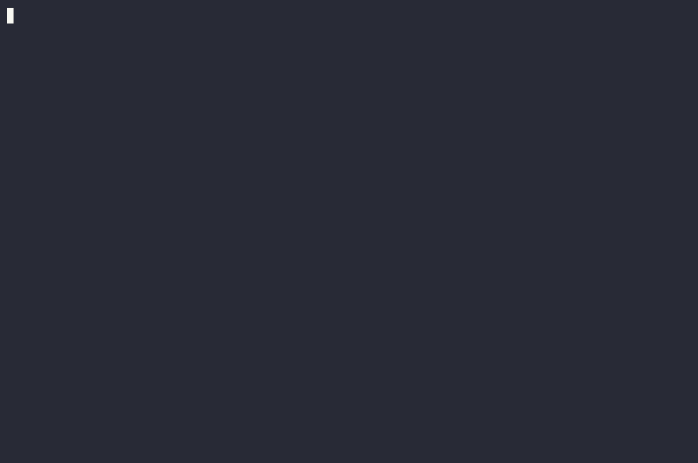

<p align="center">
  <a href="https://0.security/">
    <picture>
      <source media="(prefers-color-scheme: dark)" srcset="assets/readme/header-dark.svg">
      
    </picture>
  </a>
</p>

<h1 align="center">Open-source AI security agents</h1>

<p align="center">
  <sub>By the Swiss Applied AI &amp; Cybersecurity Research Lab</sub>
</p>

<p align="center">
  <sub>Backed by</sub>
  <a href="https://www.ycombinator.com/companies/0security"></a>
</p>

<p align="center">
  <a href="https://github.com/0sec-labs/0security/releases/latest"></a>
  <a href="LICENSE-MIT"></a>
  <a href="https://github.com/0sec-labs/0security/stargazers"></a>
</p>

<p align="center">
  0security is open-source software to deploy persistent AI security agents that find and fix security risks across any tech stack, work with any model, and run anywhere.
</p>

<p align="center">
  <a href="https://docs.0.security/"><picture><source media="(prefers-color-scheme: dark)" srcset="assets/readme/nav-docs-dark.svg"></picture></a>
  <a href="https://0.security/research/"><picture><source media="(prefers-color-scheme: dark)" srcset="assets/readme/nav-research-dark.svg"></picture></a>
  <a href="#quick-start"><picture><source media="(prefers-color-scheme: dark)" srcset="assets/readme/nav-install-dark.svg"></picture></a>
  <a href="https://0.security/enterprise/"><picture><source media="(prefers-color-scheme: dark)" srcset="assets/readme/enterprise-button-dark.svg"></picture></a>
</p>

<p align="center">
  
</p>

<p align="center">
  <a href="assets/readme-ui-demo.mp4">
    <picture>
      
    </picture>
  </a>
</p>

## Quick start

```bash
curl -fsSL https://raw.githubusercontent.com/0sec-labs/0security/main/install.sh | bash
export OPENAI_API_KEY="your-api-key"
0security scan ./your-repo
```

The installer adds the command as `0security` and as the short alias `0`. Both run the same program.

That scans the folder, prints a report and stops at a $5 budget. Any model provider works: set its key instead (see [Models](https://docs.0.security/models/)).

Windows, Docker and source installs are in the [docs](https://docs.0.security/). Only scan code you own or are authorized to test.

## Where you use it

| | For | Start |
|---|---|---|
| **CLI** | Scan, fix, SBOM and evidence from a terminal or a script | `0security scan .` |
| **Web console** | Threads, findings and fixes in a browser, on your machine | `0security` |
| **GitHub Action** | Scan each pull request and show the findings in GitHub's Security tab | [Pull request checks](https://docs.0.security/ci/) |

## What it does

- **Reviews code.** A fast scanner pass, then a model reads the code. Large repositories are reviewed in batches you can resume.
- **Keeps one list of findings.** Import SARIF or GitHub alerts from other scanners, then triage, suppress and export.
- **Fixes findings as pull requests.** One branch and PR per finding. It never pushes to your base branch.
- **Produces evidence.** SBOMs, license and advisory checks, and CRA report drafts.
- **Reviews AI apps.** LLM apps, MCP servers and live model endpoints.

It is one binary and uses your own model keys. Run `0security` for an optional web console.

## Learn more

[Documentation](https://docs.0.security/) · [Command reference](https://docs.0.security/commands/) · [Models](https://docs.0.security/models/) · [Extensions](https://docs.0.security/extensions/) · [Security research](https://0.security/research/) · [Enterprise](https://0.security/enterprise/)

## Contributing

Report bugs in [issues](https://github.com/0sec-labs/0security/issues), improve the docs, or write a skill or extension. Start with the [contributing guide](.github/CONTRIBUTING.md), and open an issue before large changes. To report a vulnerability in 0 itself, see [SECURITY.md](.github/SECURITY.md).

<a href="https://github.com/0sec-labs/0security/graphs/contributors">
  
</a>

## What is open and what is not

| Part | License | What you can do |
| --- | --- | --- |
| Core: CLI, engine, web console, GitHub Action, SBOM, evidence, the verifiers `audit-verify` and `evidence verify`, OIDC | MIT OR Apache-2.0 | Use, change and redistribute, in production too. |
| The `enterprise/` folder: license key, shared findings server, roles (RBAC), SCIM, SAML, signed evidence, audit chain retention | 0security Enterprise License (source-available) | Read and modify it. Run it for development and testing. Production use needs a license key. |

The `enterprise/` folder is source-available, not open source. Features already in the open core will not move into `enterprise/`.

## License

[MIT](LICENSE-MIT) OR [Apache-2.0](LICENSE-APACHE), except the `enterprise/` directory, which has its own license and needs a key in production. See [LICENSING.md](LICENSING.md).
